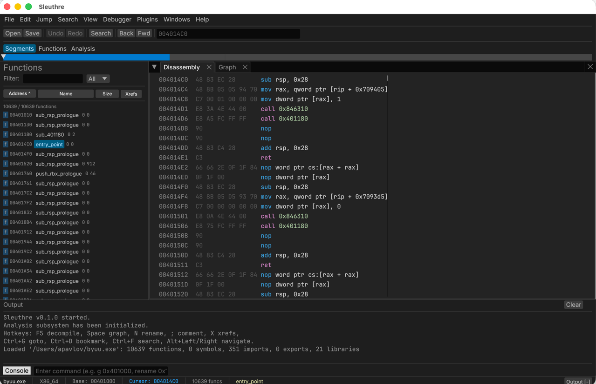

# Your first analysis

This tutorial takes a clean checkout of sleuthre to a saved project. You will build the
workspace, open a compiled binary, move through its functions, read decompiled pseudocode,
record a rename and a comment, produce a triage report, and save and reopen the project.

You do not need a sample binary: the tutorial uses the `re-cli` executable that `cargo build`
produces. On macOS that is a Mach-O file, on Linux an ELF file, and on Windows a PE file, so the
same steps exercise a real format on every platform.



## Before you start

- A Rust toolchain with edition 2024 support.
- A terminal at the repository root.
- No network access is required after dependencies are fetched.

## 1. Build and launch

```sh
cargo build
cargo run -p re-gui
```

The first build compiles the four workspace crates and can take a few minutes. Later launches are
much faster.

## 2. Open a binary

In the GUI, choose **File → Open Binary…** and select the `re-cli` executable under `target/debug/`:

- macOS: `target/debug/re-cli`
- Linux: `target/debug/re-cli`
- Windows: `target\debug\re-cli.exe`

sleuthre analyzes the file in a background worker and shows a loading overlay with the current
analysis stage. The interface becomes interactive when the project is ready.

When loading finishes, the **Functions** list in the left panel contains discovered functions and
the main view shows disassembly at a sensible starting function: the last viewed address for a
saved project, otherwise a recognized `main`/`_start`, otherwise the first executable function.

## 3. Move through functions

1. Click an entry in the **Functions** list. The disassembly view jumps to its first instruction
   and the navigation band highlights the function's range.
2. Use **Jump → Go to Address** (`Ctrl+G`, macOS: `Cmd+G`) to jump to a specific address. The
   command bar also accepts a function name.
3. Right-click an instruction for **Rename (N)**, **Comment (;)**, **Xrefs (X)**, and
   **Decompile (F5)**.
4. Press `X` while an address is selected to list cross-references to it. Click a row in the
   **Xrefs to …** window to navigate to the referring instruction.

The disassembly view does not follow a call target when you click the `call` line; use the
cross-reference window or **Go to Address** instead.

## 4. Look at the graph and the pseudocode

- Press `Space` to open the **Graph** view for the selected function. Basic blocks are laid out in
  layers; back edges are highlighted.
- Press `F5` to decompile the selected function. The **Pseudocode** view shows C-like output, and
  the cursor follows the function you have selected.

You can also open these views from **Windows → Graph** and **Windows → Pseudocode**.

## 5. Record what you learned

With an address selected:

- Press `N`, type a name, and press **Enter** to rename the function. This is recorded as an undoable
  edit.
- Press `;`, type a comment, and press **Enter** to attach a comment at the current address.
- Press `Ctrl+D` (macOS: `Cmd+D`) to add a bookmark.

Press `Ctrl+Z` (`Cmd+Z`) to undo an edit and `Ctrl+Shift+Z` (`Cmd+Shift+Z`) to redo it.

If the cursor is in a text field, plain-key shortcuts such as `N`, `;`, `X`, and `Space` are
suppressed so they do not interfere with typing.

## 6. Produce a triage report

Choose **Windows → Triage**. The Triage view summarizes the original file at load time:

- SHA-256 digest, format, architecture, entry point, and file entropy.
- Segment count, import count, and the extracted findings (strings and constants).

Click a finding to highlight its bytes in **Hex View**. Use **Export JSON…** or **Export
Markdown…** to write the report to a file. The same report is available later through
`get_triage_report` in the MCP server and from the command line:

```sh
cargo run -p re-cli -- triage target/debug/re-cli --format markdown
```

## 7. Save and reopen the project

1. Choose **File → Save Project…**.
2. Save as `re-cli.slre` somewhere convenient.
3. Close the project or restart the application.
4. Choose **File → Load Project…** and select `re-cli.slre`.

The project reopens with your rename, comment, bookmark, and the last viewed address. A `.slre`
project is self-contained: it stores the mapped bytes and the analysis results, so you do not need
the original executable to reopen the project.

## What you learned

You have used the main analysis loop: open, navigate, decompile, annotate, triage, save. From here:

- [Triage a sample](../how-to/triage-a-sample.md) shows batch and MCP workflows for reports.
- [Analyze a binary from the CLI](../how-to/use-the-cli.md) covers every headless subcommand.
- [IL and decompiler](../explanation/il-and-decompiler.md) explains how the pseudocode is produced.
